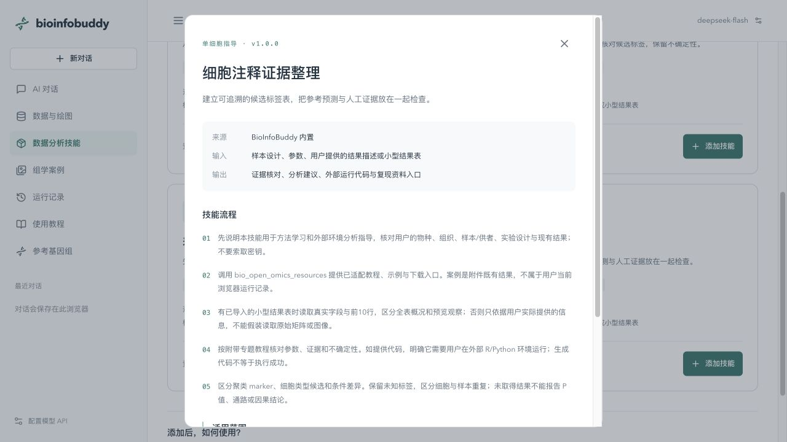

# 细胞注释理论与实操指南

建立可追溯的候选标签表，把参考预测与人工证据放在一起检查。

适用范围：教学与外部环境复现；本站不运行原始组学分析。

## 注释是一条证据链

细胞注释根据表达特征、参考图谱与实验背景，给细胞或细胞群赋予候选身份。先分主要谱系，再考虑亚型或状态；记录标记特异性、覆盖度、矛盾证据和未解决的问题。

聚类是算法分组，注释是生物学解释，两者不一一对应。一个类型可分布在多个 cluster，同一个 cluster 也可能包含混合类型。未知群需要进一步验证，不能仅凭 marker 法就宣称发现新细胞类型。

## 两类策略怎样配合

两类结果可交叉验证。参考预测并非绝对客观真值，人工判断也不必然优于模型；分歧应成为复核对象。记录参考集名称、版本、预处理、评分及不确定标签。SingleR 可在外部 R 环境使用，本站没有自动注释执行器。

| 策略 | 优势 | 局限 |
| --- | --- | --- |
| Marker-based | 证据易解释，可结合组织背景逐项检查 | 受先验知识、标记特异性与表达稀疏性限制 |
| Reference-based，例如 SingleR | 借助已注释参考得到可复核的预测 | 依赖参考质量、物种、组织与标签粒度，未知群可能被强制分配或应保留未确定 |

## 跟着网页完成一次候选注释

- 在“组学案例 → 单细胞”阅读 PBMC 数据说明，依次查看 UMAP、DotPlot 与 FeaturePlot。图上按 marker 组合命名的标题仅供对照。
- 下载单细胞复现包，在独立 R 环境运行脚本。检查实际输出 marker_summary.csv、分析说明和 sessionInfo.txt。
- 对每个 cluster 整理多个候选标记、表达比例、平均表达及冲突标记。补充物种、组织和实验信息。
- 在“数据分析技能”添加“细胞注释证据整理”，点击“在对话中使用”，把候选信息写入草稿后发送。AI 只依据你提供的证据讨论。
- 在自己的结果表中记录最终候选标签与证据等级，保留原 cluster 编号。重新聚类或更换参考后另存版本，避免覆盖原始判断。

## 建议保存的注释表

| 字段 | 记录内容 |
| --- | --- |
| cluster / resolution / dims | 原分群编号、聚类参数与版本 |
| candidate_label / final_label | 初始候选、复核后标签；未知可保留 |
| positive_markers / conflicting_markers | 支持与反对该候选的基因及表达证据 |
| reference / score / uncertainty | 外部参考与版本、预测评分及不确定性 |
| reviewer / notes | 复核者、日期、争议与待验证事项 |

## 亚群与状态需要额外证据

对子集重聚类前先说明为什么需要更细标签，检查细胞数、样本覆盖和参数稳定性。谱系标记与细胞周期、应激、干扰素反应等状态特征需分开记录。

空间 Visium spot 可能混合多类细胞。直接把 PBMC 的 marker 标签搬到GBM1 示例 spot 上没有充分依据；需要针对组织的参考、空间背景与适当方法。

## 本版资料与原文的关系

四篇教程来自用户提供的 V1.0 材料，已按 BioInfoBuddy 当前入口重写，原始文本完整保留在“完整原始资料”中。原文的“新建注释”“Single + AI”“寻因数据库”“结果总览”等界面不属于当前网站。

网站中的案例图是附件已有结果，页面截图则来自本版实际网页。代码修订记录与环境指南随资料包提供；本版不把代码语法检查称作跨平台全流程复现成功。

## 官方参考

- [SingleR 官方手册](https://bioconductor.org/books/release/SingleRBook/)
- [Seurat PBMC 工作流](https://satijalab.org/seurat/articles/pbmc3k_tutorial.html)
